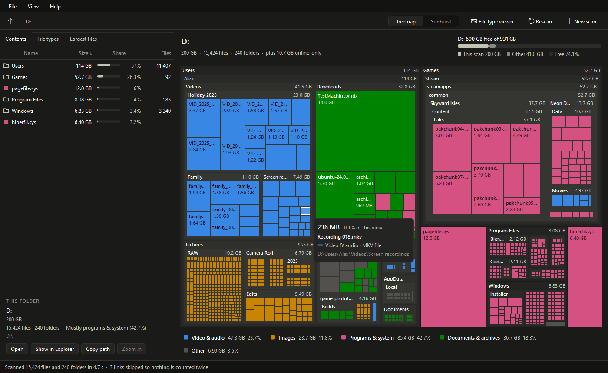
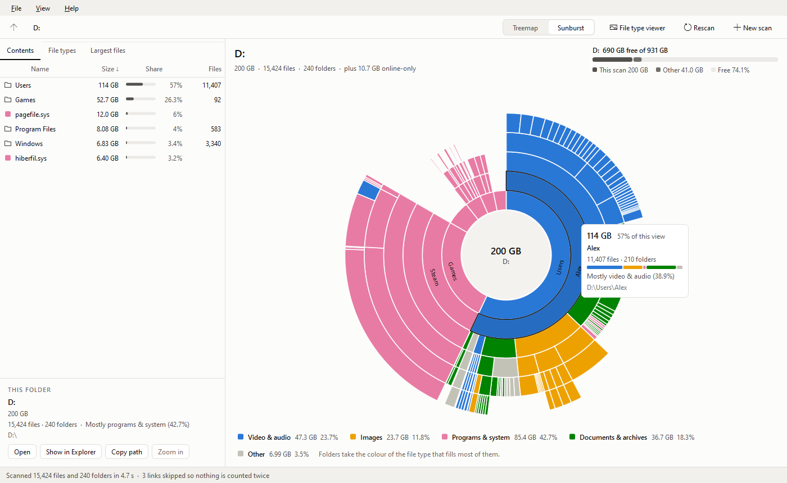
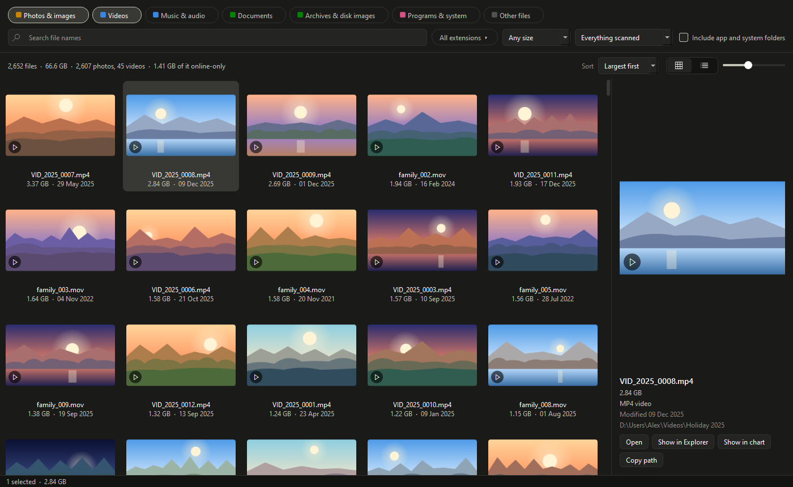
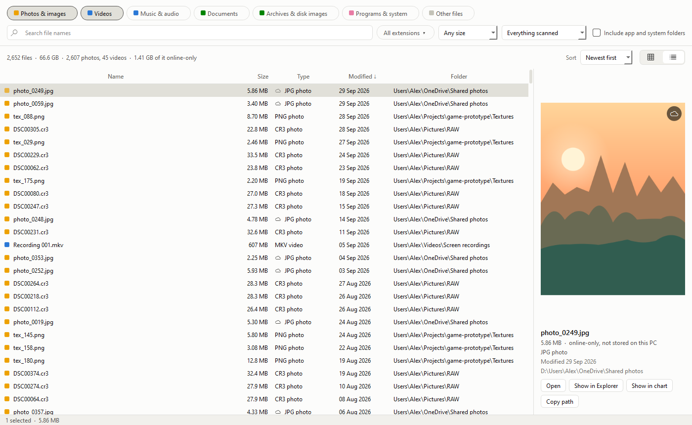

# Storage Visualizer

See what is taking up space on your drives. Scan a drive or a folder, then explore it as a
**treemap** or a **sunburst**, with tables of its contents, file types and largest files alongside.
The **file type viewer** shows every photo, video or other kind of file in the scan in one window.



## Run it

You need Python 3.12 or newer and PySide6:

```bash
python -m pip install -r requirements.txt
```

```bash
python storage_visualizer.py
```

Or double-click `StorageVisualizer.pyw` to open it without a console window.

You can also start a scan straight away, try it on made-up data, or pick a theme:

```bash
python storage_visualizer.py "D:\Games"
```

```bash
python storage_visualizer.py --demo
```

```bash
python storage_visualizer.py --theme light
```

## What it does

- **Start page.** Click a drive or one of your folders (Home, Documents, Downloads and so on), choose
  any folder, or drop a folder onto the window. Drives that are nearly full are flagged.
- **Treemap.** Every file is a rectangle sized by its bytes, nested inside its folders. A folder too
  small to open up takes the colour of what fills it, and a patch of many tiny files shows as a fine
  mesh in their colour.
- **Sunburst.** Rings of folders around the one you are looking at. Click the centre to go up.
- **Explore.** Hover for details, click to select, double-click to zoom in. Go back up with
  Backspace, the mouse's back button, or the path at the top.
- **Tables.** *Contents* lists what is in the current folder, sortable. *File types* totals each
  extension; click one to highlight just those files in the chart. *Largest files* finds the
  biggest files anywhere below the current folder.
- **Act on things.** Use the panel under the tables or right-click: Open, Show in Explorer,
  Copy path, Zoom in, or highlight a file type.
- **Themes.** Light and dark; by default it matches Windows (View → Theme).



## File type viewer

To see all your photos and videos (or music, documents, archives, programs...), click
**File type viewer** at the top of the results or press **Ctrl+T**. It opens in its own window.



- **Pick the kinds** at the top: Photos & images, Videos, Music & audio, Documents, Archives &
  disk images, Programs & system, Other. It starts on photos and videos.
- **Narrow it down** by part of the name, by extension (only `.mov`, say), by minimum size, or to the
  folder you are looking at in the main window.
- **App and system folders are skipped** unless you tick *Include app and system folders*:
  Windows, Program Files, ProgramData, AppData, the Recycle Bin, node_modules, Steam games and the
  like. Without this, your own photos would be buried under thousands of app icons and game
  textures. Hover the tick box to see the whole list.
- **Thumbnails or a list.** Thumbnails are the ones Windows Explorer shows, so videos show a frame,
  and photos in HEIC or camera RAW formats work too when Windows has their codec. The list has
  size, type, date and folder columns; click a heading to sort. Drag the slider for bigger
  thumbnails.
- **Sort** by size, date, name or folder.
- **Act on files.** Double-click opens a file. The side panel (or right-click) also has
  *Show in Explorer*, *Copy path* and *Show in chart*, which jumps the main window to that file.
- **Other ways in.** Right-click any file in the chart for *Show all .jpg files* or *Show all
  photos & images*, double-click a row in the *File types* table, or right-click a colour in the
  key under the chart.
- **OneDrive online-only files** are listed with a cloud mark, because they are still your files.
  Their thumbnails come only from what Windows already has, so browsing never downloads them.



## How sizes are counted

- Each file counts at the size Windows reports, like Explorer's *Size* column, in Explorer's units
  (1 KB = 1024 bytes).
- OneDrive "online-only" files show up in folders but take no space on the PC, so they are left out
  of the totals. Tick *View → Count online-only files* to include them.
- Junctions, mount points and symbolic links are skipped, so nothing is counted twice. Hard links,
  such as Windows' component store, are counted once per name, as Explorer does. That can make
  `C:\Windows` look a little bigger than the space it really uses.
- Some folders are protected by Windows (`System Volume Information`, other users' folders). They
  are listed under *Help → Items that couldn't be read*. Running as administrator reads more of them.
- When you scan a whole drive, the meter above the chart compares what the scan found with the
  drive's used space. *Other* is used space the scan could not see.

## Colours

Files are coloured by type: video & audio, images, programs & system, documents & archives, and
grey for everything else. In a treemap any two types can sit side by side, so the colours were
checked pair by pair for colour-blind viewers in both themes. Four colours was the most that passed.
The colours never carry meaning alone: the key under the chart, labels, hover cards and the
*File types* table all name the types too.

## Keyboard and mouse

| Do this | To |
| --- | --- |
| Click | Select a file or folder |
| Double-click | Zoom into a folder (or into a file's folder) |
| Right-click | Open, show in Explorer, copy the path, highlight a type |
| Backspace, Alt+Up or mouse Back | Go up one level |
| Alt+Home | Back to the scanned folder |
| Click a type in the key | Highlight just that type (click again to clear) |
| Esc | Clear the highlight, then the selection |
| Ctrl+1 / Ctrl+2 | Treemap / sunburst |
| Ctrl+T | File type viewer |
| F5 | Rescan |
| Ctrl+O / Ctrl+N | Scan a folder / new scan |

In the file type viewer: Ctrl+F jumps to the search box, Enter or double-click opens a file, and
Ctrl+C copies the selected files' paths.

## Speed

On the PC it was built on, scanning all of `C:` (2 million files in 380,000 folders, 820 GB) took
about a minute and used about 600 MB of memory. Speed is limited by how fast Windows opens
folders, so the scanner reads eight folders at once.

On that scan, the file type viewer found all 25,000 photos and videos in under a tenth of a second,
because it skips every folder whose totals show none of the kinds asked for. Including the app and
system folders turned up 184,000, mostly icons and game files, in half a second.

## How it is built

```
storage_visualizer.py     starts the app
StorageVisualizer.pyw     starts it without a console window
storagevis/core/          scanning, sizes and layout maths (no Qt)
    scanner.py            multi-threaded folder walk
    model.py              the tree, totals and queries (largest files, file types)
    layout.py             squarified treemap and sunburst geometry
    categories.py         which extensions belong to which kind of file and chart colour
    finder.py             the file type viewer's search
    thumbnails.py         Windows Explorer's thumbnails, as plain pixels
    system.py             drives, special folders, long paths, Explorer
    demo.py               the made-up drive behind --demo and the screenshots
storagevis/ui/            the PySide6 windows
    file_viewer.py        the file type viewer window
    viewer_results.py     its thumbnail grid and list
    viewer_preview.py     its preview pane
    thumbnails.py         makes thumbnails on worker threads, newest request first
tests/                    pytest suite
tools/screenshots.py      redraws the pictures in docs/
```

The core never imports Qt. The views get plain tiles and segments from `layout.py` and draw them,
and widgets only talk to each other through one shared `ViewState`. So the treemap, sunburst,
tables and details panel stay in step without knowing about each other.

Window size, view and theme are saved in `settings.ini` next to the app, not in the registry.

## Tests

```bash
python -m pip install pytest
```

```bash
python -m pytest
```

The tests build small folder trees inside `tests/.tmp` and remove them afterwards.
